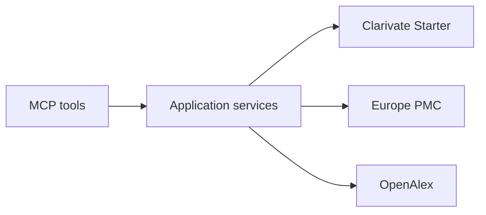

# Web of Science MCP bridge

<!-- mcp-name: io.github.hrabosh/wos-mcp-bridge -->

Search Web of Science Core Collection from an MCP client using your Clarivate
Starter API key. Find papers, retrieve bibliographic records, and pass a DOI to
Europe PMC and OpenAlex to look for an abstract, open-access links or available
full-text sections.

The bridge supports topics across disciplines, from quantum computing to urban
climate and veterinary medicine. WoS coverage depends on your subscription.
Europe PMC focuses on life sciences and biomedical literature. Clarivate Starter
supplies bibliographic metadata. Abstracts and open-access text come from the
literature tools when available.

## Try it without credentials

Install Python 3.12 and [uv 0.13.9](https://docs.astral.sh/uv/getting-started/installation/).
From a checkout or unpacked source distribution, install the locked runtime
environment and run the example:

```bash
uv sync --locked --no-dev --python 3.12
uv run --locked --no-dev python scripts/demo.py
```

The script calls the installed server over MCP stdio. An in-process HTTP fixture
inside that server subprocess supplies the synthetic record. The call is:

```json
{"name": "search", "arguments": {"query": "TS=(quantum computing)"}}
```

The **synthetic result** printed by the demo is:

```json
{
  "results": [
    {
      "id": "WOS:SMOKE001",
      "title": "Synthetic quantum computing paper",
      "url": "https://www.webofscience.com/wos/woscc/full-record/WOS:SMOKE001"
    }
  ]
}
```

## Run with your WoS key

Configure your MCP client to launch the installed `wos-mcp-bridge` command over
stdio. Use the client's secret settings to pass `WOS_API_KEY` to the process.
`OPENALEX_API_KEY` is optional. The application reads environment variables at
startup. For a local check from Bash:

```bash
read -rsp 'Clarivate Starter API key: ' WOS_API_KEY
echo
export WOS_API_KEY
uv run --locked --no-dev wos-mcp-bridge
```

The process waits for an MCP client on stdin and stdout. You can verify the
installation without credentials using `wos-mcp-bridge --version`.

Set `WOS_MCP_PROFILE=literature` to use the four Europe PMC and OpenAlex tools
without a Clarivate key. See the [deployment guide](docs/usage.md#deployment) for
authenticated Streamable HTTP and managed hosting.

## Tools

| Tool | Purpose |
| --- | --- |
| `search(query)` | First 10 results by relevance; returns `id`, `title`, and `url`. |
| `fetch(id)` | Bibliographic metadata for a `WOS:` accession ID; not an article PDF. |
| `search_wos(query, limit=10, page=1, sort="RS+D")` | One page of detailed results, exact query, total count, DOIs, and quota information. |
| `search_literature(query, limit=10, cursor="*", max_chars=10000)` | One Europe PMC page with abstracts and DOI/PMCID deduplication. |
| `resolve_article(identifier, max_chars=10000)` | DOI/PMID/PMCID resolution, abstract, access status and OpenAlex OA links. |
| `get_article(identifier, max_chars=10000, include_text=True)` | Available Europe PMC OA XML as bounded article sections; otherwise metadata/abstract. |
| `get_article_section(identifier, section_id, offset=0, max_chars=10000)` | One section or a character slice, with `next_offset` for continuation. |

All tools publish explicit input and output schemas. Detailed records include a common
`bibliography` object while preserving legacy author/year fields. See the
[data contracts](docs/contracts.md) for types, null semantics and compatibility.

See the [user guide](docs/usage.md) for search syntax, data provenance, rate
limits, caching, text budgets and troubleshooting.

## Architecture



The server factory owns its clients and closes them at shutdown. Provider
clients validate responses before caching them. The adapters validate tool
responses and expose schemas for client discovery. The
[architecture decision](docs/decisions/0001-application-composition.md) explains
the service boundaries and client ownership.

## Project status

[GitHub Actions](https://github.com/hrabosh/wos-mcp-bridge/actions) defines checks
for Python 3.12 and 3.14, lint, type checking and installation from built artifacts.
See the [changelog](CHANGELOG.md) for the 0.1.0 release and migration notes, and
the [release guide](docs/releasing.md) for distribution and verification.

For development setup and ordinary issues, see [Contributing](CONTRIBUTING.md).
For vulnerability reports, see the [security policy](SECURITY.md).

## License and data access

The code is licensed under [Apache-2.0](LICENSE). See [NOTICE](NOTICE).
You can run the bridge yourself with your own provider credentials and
entitlements. Provider API access and bibliographic metadata remain subject to
their applicable terms. Article text carries its own license. Review that license
before reusing the text, and confirm provider permissions before hosting the
service for others or redistributing records. The repository provides the
self-hosted bridge. A paid hosted service would require separate arrangements
for credentials, quotas, data rights and support.
